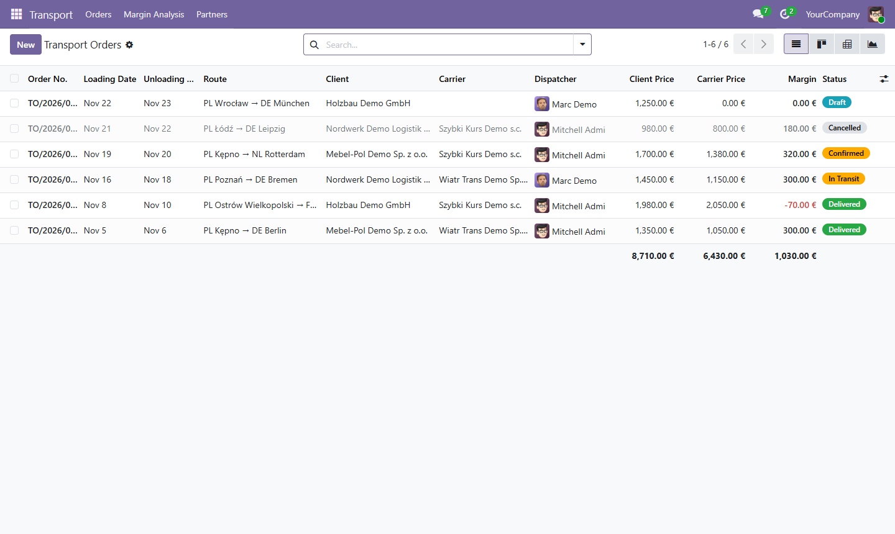
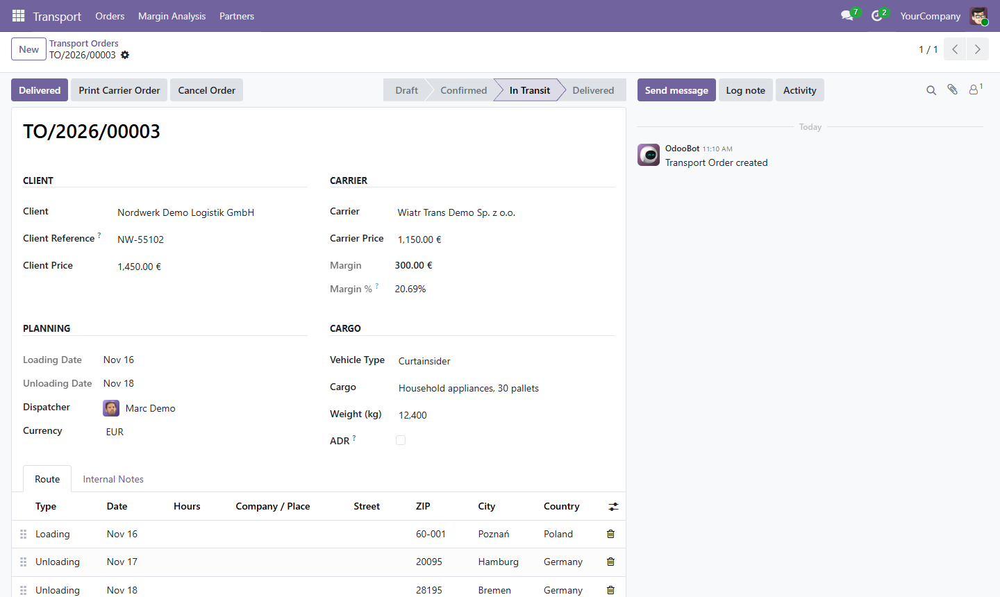
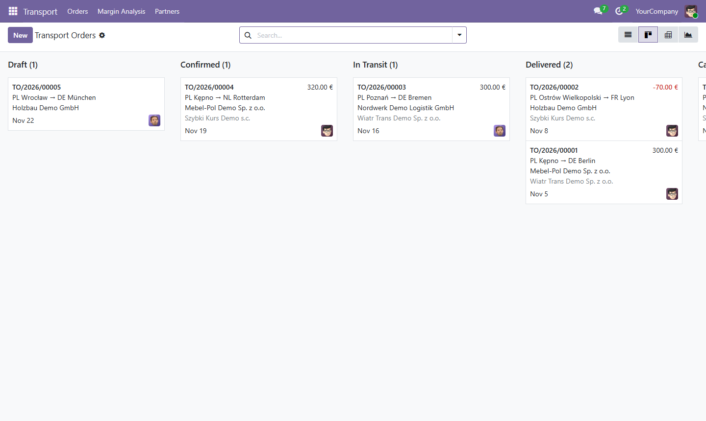
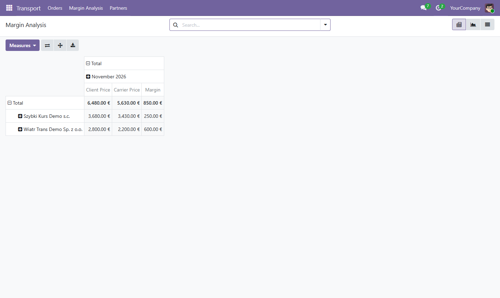
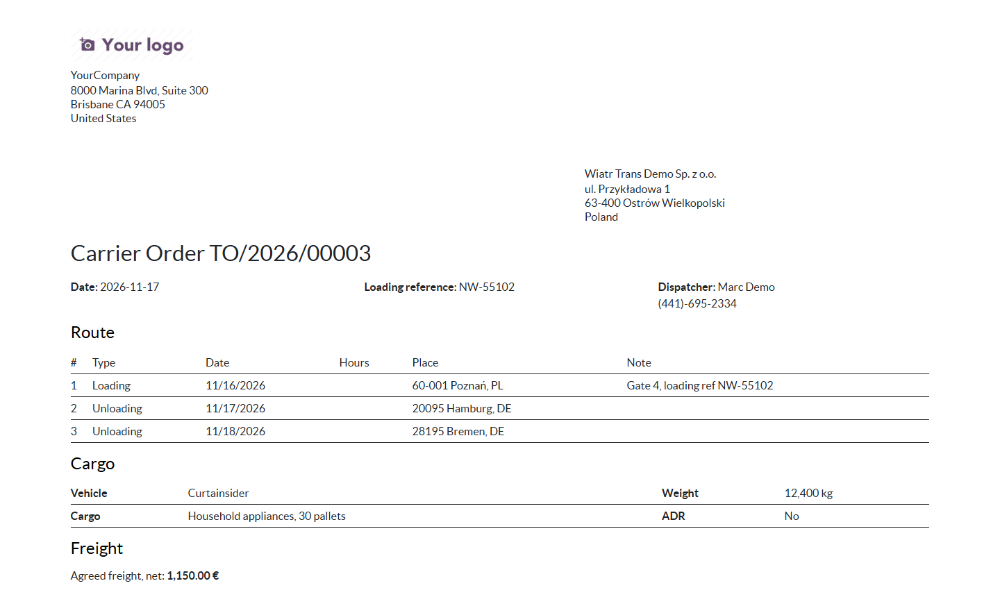

# Transport Orders for Odoo 19

An Odoo 19 Community module for a small freight forwarding office: the firm takes a shipment from a client,
hands it over to an external carrier and earns the difference.

I know this process from the inside: I worked in the back office of a Polish forwarding company
(client and carrier invoices, payment terms, documents). The module models the core of that work
the way Odoo does it, so it can be explained and extended in a standard Odoo way.

Built AI-assisted: I described the process and the rules, Claude Code wrote the code,
and I checked the result in Odoo and with the automated tests.

## What it does

| Area | Details |
|---|---|
| Orders | Client, client reference, carrier, dispatcher, cargo (vehicle type, weight, ADR), internal notes |
| Route | Ordered list of loading and unloading stops (drag to reorder); route label, loading and unloading dates are computed from the stops |
| Money | Client price, carrier price, margin and margin %; no margin until a carrier is chosen; red warning when the margin is negative; totals in the list; margin analysis counts confirmed orders only |
| Status flow | Draft → Confirmed → In Transit → Delivered, plus Cancelled. Allowed moves live in one dictionary (`_TRANSITIONS`) and one method writes the status (`_set_state`) |
| Rules | Cannot confirm without a carrier, both prices and dated stops; no unloading before the first loading; prices cannot be negative (SQL `CHECK`); delivered and cancelled orders are locked |
| Carrier order PDF | QWeb report for the carrier: route, cargo, carrier price. It never shows the client price, the margin, the client's name or the internal notes (a test checks this) |
| Access | Dispatcher: full daily work, no delete. Manager: can delete draft/cancelled orders and reopen cancelled ones. Multi-company record rules |
| Views | List, form with chatter (field tracking), kanban by status, pivot and graph for margin by carrier and month, search filters and group-bys |
| Partners | "Carrier" checkbox on contacts, Clients and Carriers menus, smart button with the partner's orders |
| Languages | English source strings, full Ukrainian translation (`i18n/uk.po`). The carrier order PDF is printed in the carrier's language (`t-lang`). Demo texts (cargo, notes) are in Ukrainian |

## Screenshots

All data below is made-up demo data.

**Order list** with totals; the negative margin is red.



**Order form**: status buttons, margin, route stops, chatter with the change history.



**Kanban by status.** Cards cannot be dragged: the status changes only through the buttons.



**Margin analysis** by carrier and month (confirmed orders only).



**Carrier order** (QWeb report): route, cargo and the carrier price only. Sample PDF:
[docs/carrier_order_example.pdf](docs/carrier_order_example.pdf).



The same screens and the PDF with the Ukrainian translation: [docs/uk/](docs/uk/).

## Run it

Requires Docker Desktop.

```bash
docker compose up -d
```

Open http://localhost:8069 (local only), log in as `admin` / `admin`, then go to Apps and install
**Transport Orders**. To get sample data, create the database with demo data, or run once:

```bash
docker compose exec odoo odoo module force-demo -d odoo --db_host=db --db_user=odoo --db_password=odoo
```

## Run the tests

The tests install the module into a separate throwaway database:

```bash
docker compose exec odoo odoo --db_host=db --db_user=odoo --db_password=odoo -d transport_test --with-demo -i transport_order --test-tags=/transport_order --stop-after-init --http-port=8079 --gevent-port=8078
```

(The spare ports keep the test run from clashing with the server that is already running on 8069.)

19 tests cover numbering, margin (none before a carrier is chosen), route computation, date and price rules, the status flow,
locking, delete rules, access rights (dispatcher vs manager), copy, the partner smart button
and the content of the carrier PDF.

## Module layout

```
addons/transport_order/
├── __manifest__.py              module name, version, dependencies, data files
├── models/
│   ├── transport_order.py       the order: fields, computed margin and route, status flow, locks
│   ├── transport_order_stop.py  loading and unloading stops
│   └── res_partner.py           "Carrier" flag and order counter on contacts
├── security/                    groups (Dispatcher, Manager), access rights, multi-company rules
├── data/ir_sequence_data.xml    order numbers TO/2026/00001
├── views/                       list, form, kanban, search, pivot, graph, menus, partner form
├── report/                      carrier order PDF (QWeb)
├── demo/                        made-up clients, carriers and 6 orders in different statuses
└── tests/                       automated tests
```

## Design choices

- **Status changes only through buttons.** A direct `write({'state': ...})` is refused, so the
  rules in `_TRANSITIONS` cannot be bypassed from the UI, an import or the API. Kanban cards cannot
  be dragged between columns for the same reason.
- **Computed, stored fields** for margin, route and dates: they are always consistent with the
  prices and stops and can still be searched, grouped and summed.
- **Database constraint for prices**, Python constraints for rules that need several records
  (stop dates).
- **Standard Odoo first**: contacts are regular `res.partner` records, chatter and tracking come from
  `mail`, numbering from `ir.sequence`, PDFs from the QWeb report engine.

## Not done yet

- One currency per order: client and carrier price are in the same currency. Converting with
  `res.currency` rates is the next step.
- No invoicing: the natural next step is creating the client invoice and the carrier bill in
  Odoo Accounting from a delivered order.
- Polish translation (`i18n/pl.po`) is planned; Ukrainian is done.

## License

LGPL-3
